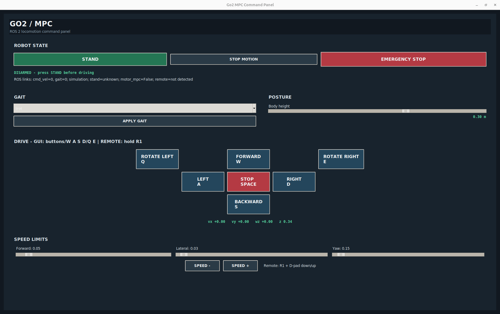
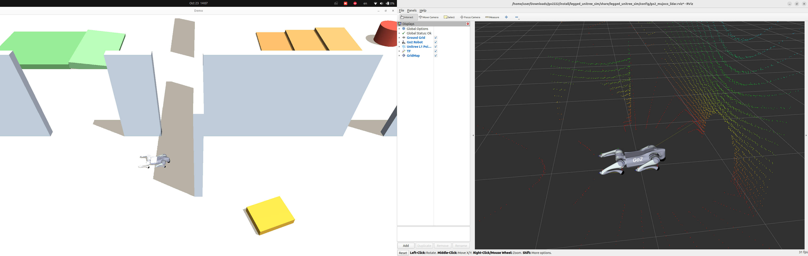
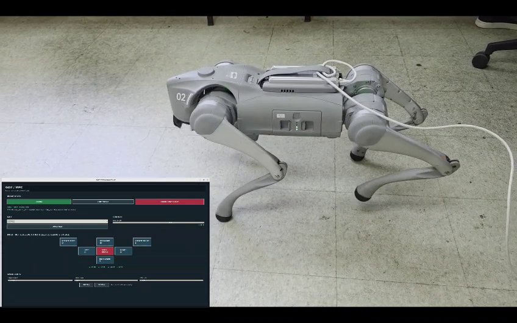

# Nonlinear MPC for Unitree Go2

ROS 2 Jazzy workspace for nonlinear model predictive control (NMPC), whole-body control (WBC), state estimation, and simulation of the Unitree Go2 quadruped.

The controller uses OCS2 SQP-MPC to optimize body motion and contact forces, then a weighted or hierarchical whole-body controller (WBC) converts the plan into joint commands. The real Go2 and MuJoCo pipelines have both been operated successfully in the project maintainer's setup, with very good results. The Gazebo Sim pipeline is still under active development.

> [!WARNING]
> This is research software, not a safety-certified product. Real Go2 operation has been completed successfully in the maintainer's setup, but results depend on the robot, network, and environment. Follow the hardware startup sequence, keep people clear of the robot, and retain access to the robot's emergency stop.

## Project status

| Pipeline | Status |
|---|---|
| Go2 real hardware | Deployed and operated successfully by the project maintainer, with very good results |
| MuJoCo | Running successfully; includes gait and elevation-mapping demonstrations |
| Gazebo Sim | Work in progress; launch is provided for development and is not yet a validated workflow |
| Elevation/perception | Experimental; dense 3-D signed-distance-field constraints are not connected to the Go2 NMPC |

## Features

- ROS 2 Jazzy and Ubuntu 24.04
- Unitree Go2 centroidal-dynamics NMPC with OCS2
- Pinocchio rigid-body dynamics and kinematics
- Weighted and hierarchical whole-body controllers
- Kalman-filter state estimation from joints, IMU, and foot contacts
- MuJoCo backend; Gazebo Sim integration is in progress
- Runtime gait selection and `/cmd_vel` motion commands
- Elevation mapping and perceptive-terrain processing pipeline

## Control architecture

```text
joint, IMU and contact measurements
                |
                v
        state estimation
                |
                v
       OCS2 nonlinear MPC
    desired motion + contact forces
                |
                v
     whole-body control (WBC)
       joint torque commands
                |
                v
          ros2_control
          /           \
     MuJoCo         Gazebo Sim
```

## Workspace layout

```text
src/
|- leggedcontrol_go2/
|  |- legged_controllers/      ROS 2 controller, gait and command tools
|  |- legged_interface/        OCS2 optimal-control problem
|  |- legged_estimation/       Floating-base state estimation
|  |- legged_wbc/              Whole-body control
|  |- legged_common/           Shared interfaces and definitions
|  |- legged_examples/         Go2 description, simulation and hardware packages
|  `- src/ocs2/                Vendored OCS2 ROS 2 source
|- unitree_go2_ros2_jazzy/     Go2 model and MuJoCo ros2_control bridge
`- elevation_mapping_cupy_ros2_ws/
                               GPU elevation-mapping integration
```

The main Go2 parameters are in:

```text
src/leggedcontrol_go2/legged_controllers/config/go2/task.info
src/leggedcontrol_go2/legged_controllers/config/go2/reference.info
src/leggedcontrol_go2/legged_controllers/config/go2/gait.info
```

## Installation

### Supported reference environment

The following versions are from the project maintainer's working development machine (Ubuntu 24.04, October 2026). They are a reproducibility reference, not a promise that every Ubuntu mirror will offer the exact same dated Debian package build.

| Dependency | Reference version |
|---|---|
| Ubuntu | 24.04.3 LTS |
| ROS 2 | Jazzy |
| GCC | 13.3.0 |
| CMake | 3.28.3 |
| Pinocchio | 3.8.0 (`ros-jazzy-pinocchio`) |
| hpp-fcl | 2.4.5 (`ros-jazzy-hpp-fcl`) |
| Eigen | 3.4.0 |
| Boost | 1.83.0 |
| `ros2_control` | 4.44.0 |
| `controller_manager` | 4.42.2 |
| `gz_ros2_control` | 1.2.17 (Gazebo integration is WIP) |
| MuJoCo | 3.10.0, standalone release |

Use one consistent Pinocchio/hpp-fcl installation. Avoid mixing headers or libraries from `/opt/ros/jazzy` with a second copy in `/usr/local`; that can create C++ API and ABI mismatches.

### Install ROS 2 and system dependencies

Use Ubuntu 24.04 with ROS 2 Jazzy installed from the official ROS packages. Install the build tools and system libraries:

```bash
sudo apt update
sudo apt install -y \
  build-essential cmake git \
  python3-colcon-common-extensions python3-rosdep python3-vcstool \
  python3-dev pybind11-dev \
  libeigen3-dev libboost-all-dev libglfw3-dev \
  libglpk-dev libgmp-dev libmpfr-dev libcgal-dev \
  libopencv-dev libpcl-dev liburdfdom-dev \
  ros-jazzy-eigen3-cmake-module ros-jazzy-pinocchio ros-jazzy-hpp-fcl \
  ros-jazzy-xacro ros-jazzy-robot-state-publisher ros-jazzy-rviz2 \
  ros-jazzy-ros2-control ros-jazzy-ros2-controllers \
  ros-jazzy-imu-sensor-broadcaster ros-jazzy-gz-ros2-control
```

Resolve package dependencies declared by the workspace:

```bash
sudo rosdep init 2>/dev/null || true
rosdep update
rosdep install --from-paths src --ignore-src -r -y --skip-keys pinocchio
```

`legged_gazebo` is a legacy ROS 1/Gazebo Classic package, and `helloworld` is part of the Unitree SDK examples; neither is needed for the ROS 2 Go2 targets below. The ANYmal-only `segmented_planes_terrain_model` package is also excluded from this Go2 build.

### Unitree SDK 2 (real hardware only)

Install the SDK's bundled Cyclone DDS libraries and SDK libraries into `/usr/local`. The hardware launch checks for this matching Unitree DDS pair; installing only the system Cyclone DDS package is not a substitute.

```bash
cd src/leggedcontrol_go2/legged_examples/legged_unitree/unitree_sdk2-main
sudo ./install.sh
ls -l /usr/local/lib/libddsc.so.0 /usr/local/lib/libddscxx.so.0
cd -
```

The final `cd -` returns to the workspace directory you were in before entering the SDK folder.

### MuJoCo

Install the MuJoCo 3.10.0 binary release and set `MUJOCO_DIR` to the extracted directory. For example:

```bash
export MUJOCO_DIR="$HOME/mujoco/mujoco-3.10.0"
```

Set this variable in every new terminal used to build or launch MuJoCo. If you install another MuJoCo version, verify that `mujoco_ros2_control` supports its rendering API.

### Clone and build

```bash
git clone https://github.com/AUB-RoboticsTeam/non-linear-mpc-go2.git
cd non-linear-mpc-go2

source /opt/ros/jazzy/setup.bash
export MUJOCO_DIR="$HOME/mujoco/mujoco-3.10.0"  # change to your install location

colcon build --symlink-install \
  --packages-up-to legged_unitree_hw legged_unitree_sim legged_controllers \
  --packages-ignore helloworld legged_gazebo segmented_planes_terrain_model

source install/setup.bash
```

After rebuilding a controller or simulator plugin, fully restart the simulator so it loads the new shared library. The optional CuPy elevation-mapping pipeline needs a compatible NVIDIA driver/CUDA setup; it is not required for the core controller build.

## Important launch commands

Open a new terminal for each launch, then source ROS and this workspace in each terminal:

```bash
source /opt/ros/jazzy/setup.bash
source install/setup.bash
export MUJOCO_DIR="$HOME/mujoco/mujoco-3.10.0"  # needed by MuJoCo
```

These are the main launch commands.

### Go2 hardware

```bash
ros2 launch legged_unitree_hw go2.launch.py \
  network_interface:=eno1 \
  load_mpc_controller:=true \
  start_controller:=false \
  release_mode_on_arm:=true \
  max_torque:=30.0 \
  arm_ramp_duration:=5.0
```

Replace `eno1` with the Go2-facing Ethernet interface on your computer (for example, check `ip -br link`). This launch loads the MPC controller but leaves it inactive; use the command GUI's **STAND** workflow to stand and hand over to MPC.

### MuJoCo elevation world

```bash
ros2 launch legged_unitree_sim go2_mpc_mujoco_elevation.launch.py \
  rviz:=true \
  start_controller:=true \
  start_joint_state_broadcaster:=true \
  start_command_console:=false
```

### Gazebo Sim (work in progress)

```bash
ros2 launch legged_unitree_sim go2_mpc_gz.launch.py \
  rviz:=true \
  start_joint_state_broadcaster:=true \
  start_controller:=false \
  start_command_console:=false
```

### Command GUI: stand, gait, speed, and joystick

Start the simulator or hardware launch first. Then run the GUI in a separate terminal:

```bash
ros2 launch legged_controllers command_gui.launch.py
```

In the GUI, use this sequence:

1. Press **STAND** and wait for the status to report that the robot is standing/armed. On hardware, the GUI requests the stand-up routine and then activates the MPC controller.
2. Choose a gait from the menu and press **APPLY GAIT**. Start conservatively with `stance` or `standing_trot`.
3. Set body height with the **Body height** slider. Set forward, lateral, and yaw speed limits with the sliders at the bottom of the panel.
4. Drive with the on-screen buttons or hold `W/A/S/D` for translation and `Q/E` for rotation. Press `SPACE` or **STOP MOTION** to stop. **EMERGENCY STOP** disarms the command stream; on real hardware, also know the robot's physical emergency-stop procedure.
5. With the GUI running and the controller armed, hold **R1** on the Unitree joystick while using the sticks to drive. Releasing R1 stops remote motion. The D-pad up/down with R1 adjusts the GUI speed scale.



## Quick start: MuJoCo

Start the simulator and load the controller in an inactive state:

```bash
source /opt/ros/jazzy/setup.bash
source install/setup.bash

ros2 launch legged_unitree_sim go2_mpc_mujoco.launch.py \
  start_command_console:=false
```

In a second terminal, activate the controller once the robot and interfaces are ready:

```bash
source /opt/ros/jazzy/setup.bash
source install/setup.bash

ros2 control list_controllers
ros2 control switch_controllers --activate legged_controller
```

Command a 0.30 m body height, select standing trot, and walk forward:

```bash
ros2 topic pub -1 /cmd_vel geometry_msgs/msg/Twist \
  "{linear: {x: 0.0, y: 0.0, z: 0.30}, angular: {z: 0.0}}"

ros2 topic pub -1 /legged_robot_gait_command std_msgs/msg/String \
  "{data: standing_trot}"

ros2 topic pub /cmd_vel geometry_msgs/msg/Twist \
  "{linear: {x: 0.20, y: 0.0, z: 0.0}, angular: {z: 0.0}}" -r 10
```

Stop motion and return to stance:

```bash
ros2 topic pub -1 /cmd_vel geometry_msgs/msg/Twist \
  "{linear: {x: 0.0, y: 0.0, z: 0.0}, angular: {z: 0.0}}"

ros2 topic pub -1 /legged_robot_gait_command std_msgs/msg/String \
  "{data: stance}"
```

`linear.z` is the desired body height and is latched when positive. Gait selection and velocity commands are independent.

## Quick start: Gazebo Sim (work in progress)

```bash
source /opt/ros/jazzy/setup.bash
source install/setup.bash

ros2 launch legged_unitree_sim go2_mpc_gz.launch.py \
  start_command_console:=false
```

The Gazebo pipeline is still being developed and may need launch/controller fixes. It currently uses a simulator ground-truth (`cheater`) estimator for the development pipeline. Never use the cheater controller on real hardware.

When following this development path, activate:

```bash
ros2 control switch_controllers --activate legged_cheater_controller
```

To develop against the normal IMU/contact estimator instead:

```bash
ros2 launch legged_unitree_sim go2_mpc_gz.launch.py \
  cheater:=false start_command_console:=false
ros2 control switch_controllers --activate legged_controller
```

The MuJoCo launch uses the normal `legged_controller` by default.

## Terrain perception

Launch the MuJoCo elevation/building world and perception front end:

```bash
ros2 launch legged_unitree_sim go2_mpc_mujoco_elevation.launch.py \
  start_command_console:=false
```

Validate the elevation-map input while the simulator and mapper are running:

```bash
ros2 run legged_controllers check_perception_pipeline.py --duration 5
```

The current pipeline provides 2.5-D elevation-map classification and planar regions. Dense 3-D signed-distance-field collision constraints are not yet connected to the Go2 NMPC.

## Demonstrations

The MuJoCo gait video is compressed from the original 4K-wide screen capture to keep the repository media below GitHub's 100 MB per-file limit. The original full-resolution source is retained locally as `media/mujoco_gaits_demo_original.mp4` and is intentionally excluded from Git. If you need to distribute that original, upload it to a publicly accessible video/Drive location and link it here.

| MuJoCo + RViz | Real Go2 hardware |
|---|---|
| [](media/mujoco_gaits_demo.mp4) [Watch the gait demo](media/mujoco_gaits_demo.mp4) | [](media/go2_real_hardware_trot.mp4) [Watch the hardware trot demo](media/go2_real_hardware_trot.mp4) |

## Safety and current limitations

- Use low speed limits for initial tests, keep the physical emergency stop accessible, and verify the robot is clear of obstacles and people.
- The controller is not a self-righting controller.
- Gazebo Sim integration is work in progress; simulation contact dynamics may need backend-specific tuning.
- Verify the joint order `LF, LH, RF, RH`, axis signs, IMU convention, foot mapping, and effort limits before tuning MPC weights.
- Use `simulation_mode:=false` for any real-hardware integration.

For the controller design, ROS 1/ROS 2 migration notes, simulator interface details, and debugging checklist, see [the detailed MPC guide](README_MPC_ROS2.md).

## Acknowledgements and licensing

This workspace builds on [OCS2](https://github.com/leggedrobotics/ocs2), [legged_control](https://github.com/qiayuanliao/legged_control), [elevation_mapping_cupy_ros2](https://github.com/amilearning/elevation_mapping_cupy_ros2), and the [Unitree Go2 ROS 2 Jazzy](https://github.com/RobInLabUJI/unitree_go2_ros2_jazzy) ecosystem. Upstream components retain their respective licenses; consult the license files in each source directory before redistribution or deployment.
