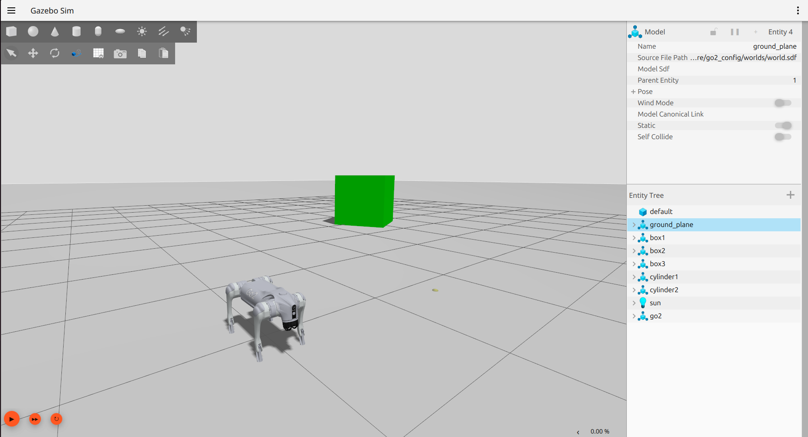
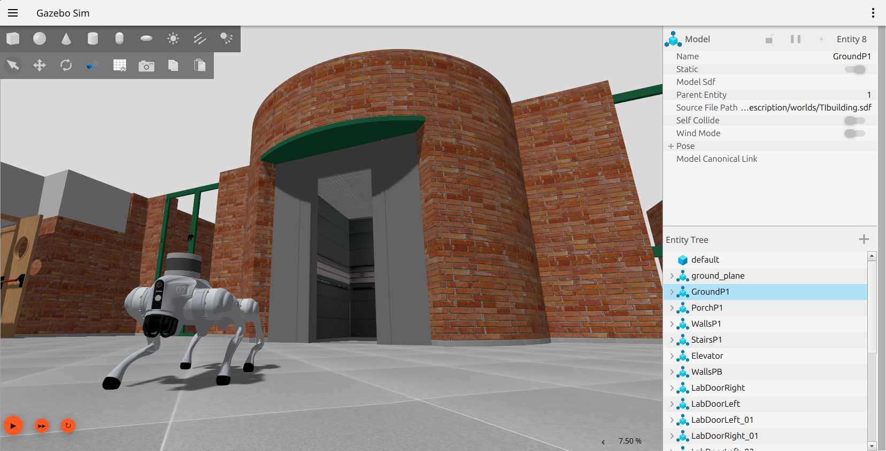
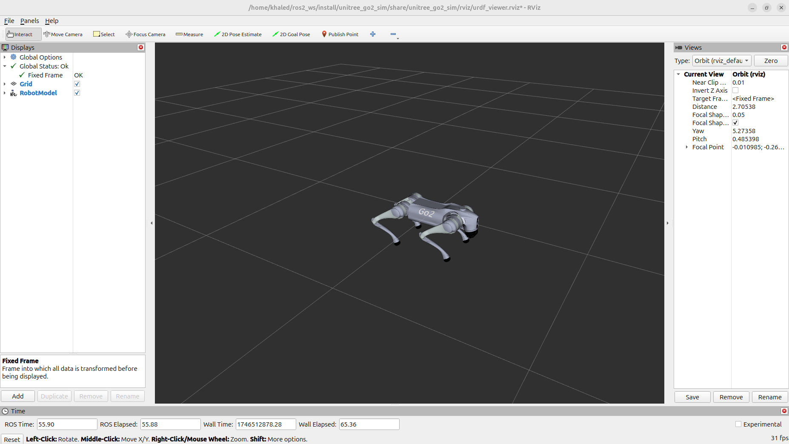
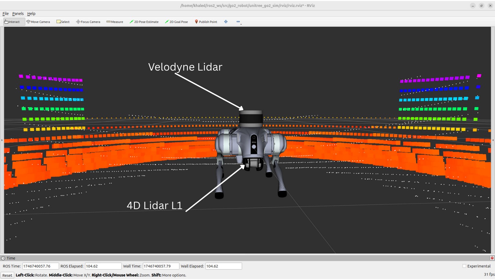
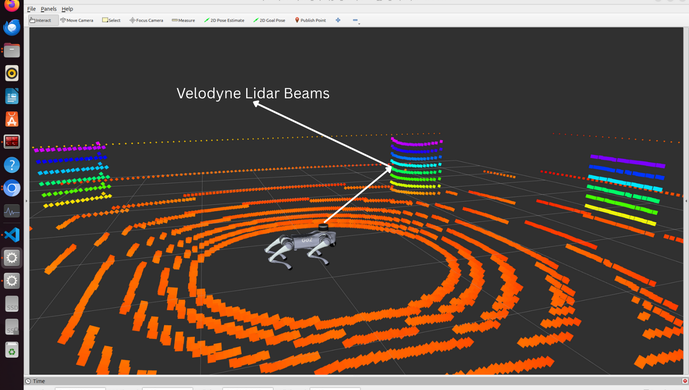
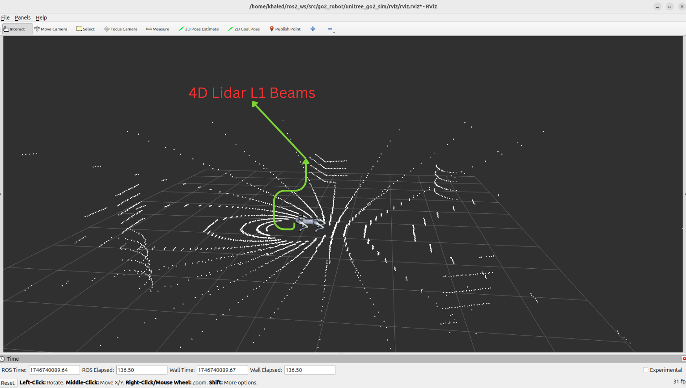
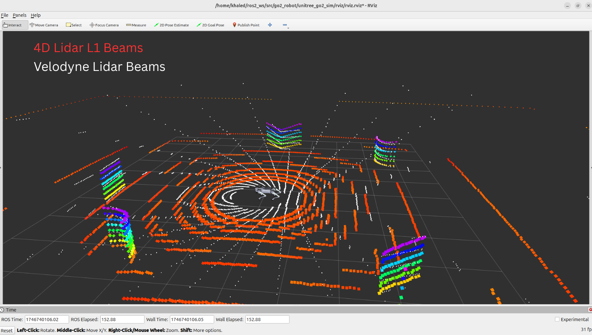
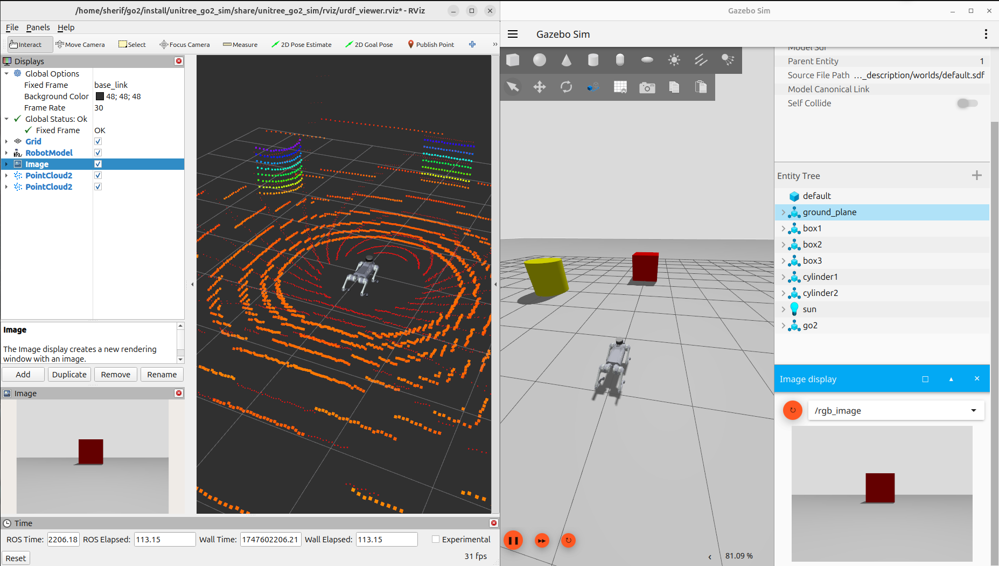
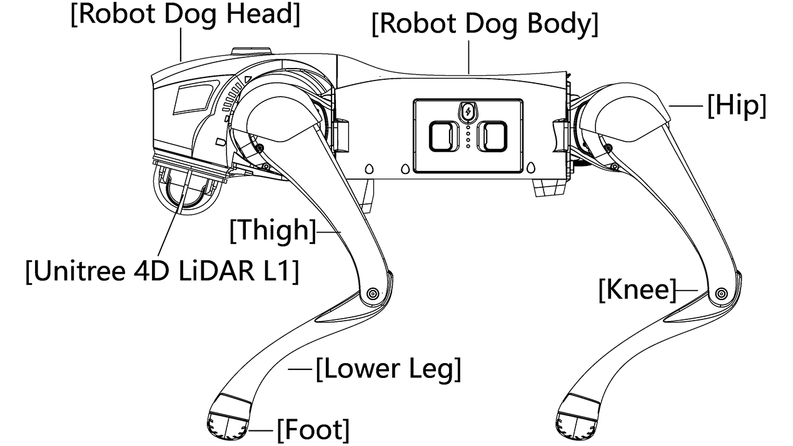

# Unitree Go2 ROS2

<p align="center">
  
</p>

## Overview

This package provides a complete ROS 2 Jazzy integration for the Unitree Go2 quadrupedal robot using the CHAMP controller framework. It includes custom configuration packages and robot description models specifically adapted for ROS 2, enabling simulation, control, and autonomous operation capabilities.

## About Unitree Go2

The Go2 is a quadrupedal robot manufactured by Unitree Robotics, designed for both research and commercial applications. It features powerful actuators, advanced sensor integration, and a robust mechanical design capable of navigating various terrains.

## About CHAMP Controller

CHAMP (Coupled Hybrid Automata for Mobile Platforms) is an open-source development framework designed for quadrupedal robots. It provides a hierarchical control system that combines pattern modulation and impedance control techniques for efficient locomotion.


## Features

- ✅ Complete ROS 2 Jazzy integration
- ✅ URDF model adapted to ROS 2 control framework
- ✅ Gazebo Harmonic simulation support
- ✅ MuJoCo simulation support (joints + IMU; see [MuJoCo Simulation](#mujoco-simulation))
- ✅ Teleoperation using keyboard
- ✅ RVIZ visualization
- ✅ Integrated gait control and configuration
- ✅ Simulated sensors (in progress):
  - ✅ IMU
  - ✅ 2D LiDAR (Hokuyo)
  - ✅ 3D LiDAR (Velodyne)
  - ✅ 3D LiDAR (4D Lidar L1) (need some imporvments)
  - ✅ Mono Camera
  - ❌ Depth Camera
  - ❌ GPS
- ✅ Point cloud visualization in RVIZ
- ✅ Multiple sensor configurations available
- ❌ Full SLAM functionality (Coming soon)
- ❌ Navigation 2 integration (Coming soon)

## System Requirements

- Ubuntu 24.04
- ROS 2 Jazzy
- Gazebo Sim Harmonic

## Installation

### 1. Install ROS 2 Dependencies

```bash
sudo apt update
sudo apt install ros-jazzy-gazebo-ros2-control
sudo apt install ros-jazzy-xacro
sudo apt install ros-jazzy-robot-localization
sudo apt install ros-jazzy-ros2-controllers
sudo apt install ros-jazzy-ros2-control
sudo apt install ros-jazzy-velodyne
sudo apt install ros-jazzy-velodyne-description
```

### 2. Clone and Install CHAMP Controller and Go2 Simulation Packages

```bash
cd ~/ros2_ws/src
git clone https://github.com/RobInLabUJI/unitree_go2_ros2_jazzy/
```

### 3. Install Dependencies

```bash
cd ~/ros2_ws
rosdep update
rosdep install --from-paths src --ignore-src -r -y
```

### 4. Build the Workspace

```bash
cd ~/ros2_ws
colcon build
source install/setup.bash
```

## Usage

### Gazebo Simulation

Launch the Gazebo simulation:

```bash
ros2 launch unitree_go2_sim unitree_go2_launch.py
```



[Watch Demo on YouTube](https://youtu.be/NUu7TaZhaQM)

Launch the Gazebo simulation in the TI building:

```bash
ros2 launch unitree_go2_sim unitree_go2_launch_TI.py
```



### MuJoCo Simulation

The robot can also be simulated in MuJoCo instead of Gazebo. Physics and
sensing go through a `mujoco_ros2_control` hardware plugin that sits in the
same `<ros2_control>` slot `gz_ros2_control` normally fills, so the rest of
the stack (the per-joint `ros2_unitree_legged_control` controllers, topic
names) is unchanged between backends.

**One-time setup**, in addition to the dependencies above:

```bash
# MuJoCo itself is not distributed via rosdep/apt: download a release from
# https://github.com/google-deepmind/mujoco/releases, extract it, then:
export MUJOCO_DIR=/path/to/mujoco-3.x.x

sudo apt install libglfw3-dev libeigen3-dev ros-jazzy-imu-sensor-broadcaster

cd ~/ros2_ws
colcon build --packages-up-to unitree_go2_sim
source install/setup.bash
```

`MUJOCO_DIR` must be set (or exported permanently in your shell profile)
every time you build or run the MuJoCo backend, since `mujoco_ros2_control`'s
`CMakeLists.txt` uses it to locate the MuJoCo library and headers.

Launch the MuJoCo simulation:

```bash
ros2 launch unitree_go2_sim unitree_go2_launch_mujoco.py
```

The robot description (`unitree_go2_robot.xacro sim:=mujoco`), the MJCF
model (`unitree_go2_description/mujoco/go2/scene.xml`, adapted from
[unitree_mujoco](https://github.com/unitreerobotics/unitree_mujoco)), and the
`imu_sensor_broadcaster` (remapped to `/imu/data`) are all wired up by the
launch file automatically.

**Known limitations of this backend today:**

- `mujoco_ros2_control` always opens its own MuJoCo/GLFW viewer window
  (there is no headless mode), separate from RViz.
- Unlike Gazebo's `PosePublisher`/`OdometryPublisher` plugins,
  `mujoco_ros2_control` does not publish the floating base's world-frame
  pose or TF/odometry — only joint states and the IMU are exposed. RViz
  won't show the robot moving through the world frame, and `worlds/*.sdf`
  terrain has no MuJoCo equivalent yet.
- The RGB camera and lidars are not yet bridged for MuJoCo (Gazebo-only for
  now).

### RVIZ Visualization

The package now includes both `Velodyne 3D LiDAR` and `4D Lidar L1` sensors. You can visualize the point cloud data in RVIZ:

Launch Gazebo with RVIZ:

```bash
ros2 launch unitree_go2_sim unitree_go2_launch.py rviz:=true
```



**Velodyne Lidar and 4D Lidar L1**



**Velodyne Lidar Beams**



**4D Lidar L1 Beams**



**Velodyne Lidar and 4D Lidar L1 Beams**



**Mono Camera**



### Teleoperation

Control the robot using keyboard:

```bash
ros2 run teleop_twist_keyboard teleop_twist_keyboard
```

## Tuning Gait Parameters

The gait configuration for the robot is found in `unitree_go2_sim/config/gait/gait.yaml`. You can modify the following parameters:

| Parameter | Description |
|-----------|-------------|
| Knee Orientation | How the knees should be bent (.>> .>< .<< .<>) |
| Max Linear Velocity X | Maximum forward/reverse speed (m/s) |
| Max Linear Velocity Y | Maximum sideways speed (m/s) |
| Max Angular Velocity Z | Maximum rotational speed (rad/s) |
| Stance Duration | How long each leg spends on the ground while walking |
| Leg Swing Height | Trajectory height during swing phase (m) |
| Leg Stance Height | Trajectory depth during stance phase (m) |
| Robot Walking Height | Distance from hip to ground while walking (m) |
| CoM X Translation | Offset to compensate for weight distribution |
| Odometry Scaler | Multiplier to calculated velocities for dead reckoning |



## Project Structure

- `champ/`: Core controllers and state estimation for CHAMP
- `unitree_go2_description/`: URDF/xacro models, meshes, world files, and the MuJoCo MJCF model (`mujoco/go2/`)
- `unitree_go2_sim/`: Simulation launch files and configuration (Gazebo and MuJoCo)
- `mujoco_ros2_control/`: Vendored `ros2_control` hardware plugin + node for the MuJoCo backend

## Contributing

Contributions are welcome! Please feel free to submit a Pull Request.

1. Fork the repository
2. Create your feature branch (`git checkout -b feature/AmazingFeature`)
3. Commit your changes (`git commit -m 'feat: Add some AmazingFeature'`)
4. Push to the branch (`git push origin feature/AmazingFeature`)
5. Open a Pull Request

## Acknowledgements

This project builds upon and incorporates work from the following projects:

* [Unitree Robotics](https://github.com/unitreerobotics/unitree_ros) - For the Go2 robot description (URDF model)
* [CHAMP](https://github.com/chvmp/champ) - For the quadruped controller framework
* [CHAMP Robots](https://github.com/chvmp/robots) - For robot configurations and setup examples
* [unitree-go2-ros2](https://github.com/anujjain-dev/unitree-go2-ros2) - ROS 2 package with gazebo classic
* [unitree_mujoco](https://github.com/unitreerobotics/unitree_mujoco) - Source of the Go2 MJCF model/meshes used by the MuJoCo backend
* [mujoco_ros2_control](https://github.com/sangteak601/mujoco_ros2_control) - `ros2_control` hardware plugin for MuJoCo, vendored in `mujoco_ros2_control/`

## License
